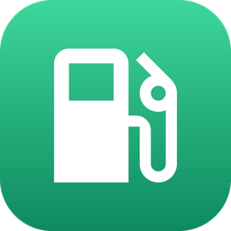
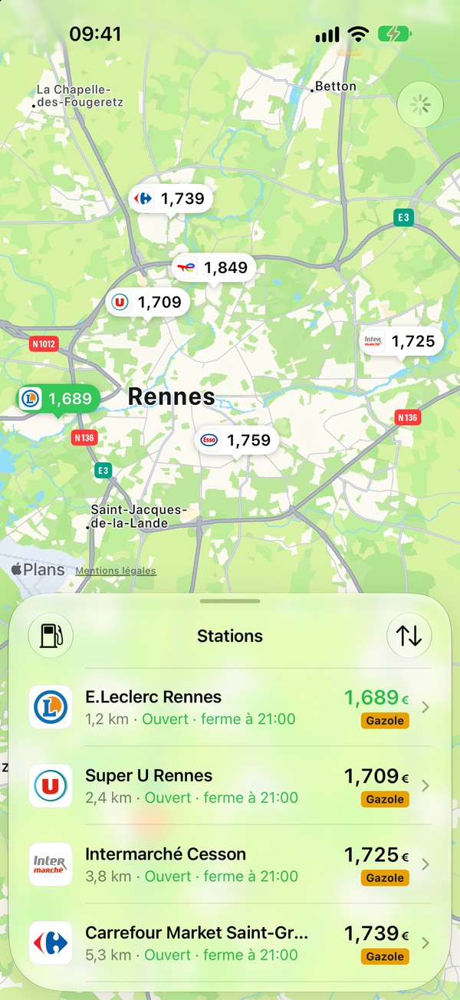
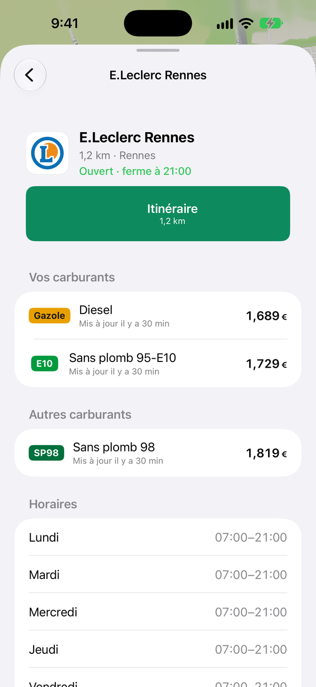
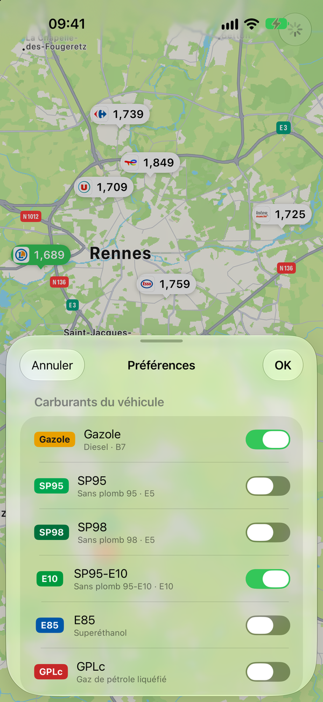
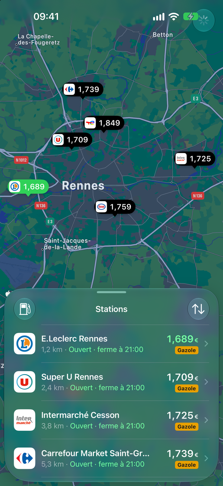
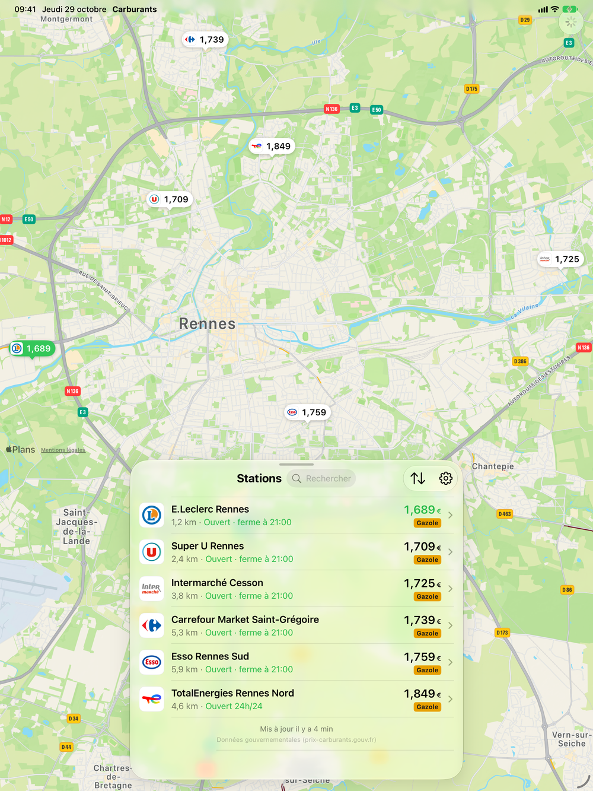

<p align="center"></p>

# Carburants — iOS, CarPlay & widgets

Nearby fuel stations and their prices for **iPhone (iPhone Duo included), iPad, CarPlay and the Home and Lock
Screens**, in SwiftUI with the system's own components, so it looks and behaves like a built-in app.
The iOS counterpart of [aaos-carburants](https://github.com/juju35/aaos-carburants) (Android Automotive).

- **Map + list**, as in Plans: each station is a price tag on the map (cheapest in green) and a row in a sheet
  you drag up and down; on a regular width (iPhone Duo unfolded, iPad) the list becomes a floating side panel;
  iPhone Duo half folded, the map and the list each take one side of the fold
  Split View and several windows work, all on the same data
- **Station card**: logo, distance, opening status, big *Itinéraire* button (Plans; long press for Google Maps or
  Waze, Plans when they are not installed), price and freshness of your fuels, the other fuels, shortages, hours of the week, services
- **Fuels**: switch on those your car takes (Gazole, SP95, SP98, E10, E85, GPLc, at least one); sorting by price uses
  the cheapest of them at each station. Choices are remembered and shared with CarPlay and the widgets
- **CarPlay** (Fueling category): map of the 12 best stations with *Y aller*, list sorted by price or distance,
  station details, fuel picker. *Y aller* hands the destination to Plans
- **Widgets**: the cheapest station (small, also shown in CarPlay), 3 / 6 / 8 stations (medium, large, extra large
  on iPad and iPhone Duo), best price on the Lock Screen (rectangular, inline, circular). Each widget can follow
  your fuels or show one in particular; tapping a station opens it in the app
- Automatic refresh after 2 km or 10 minutes, pull to refresh; 10 km radius, widened to 30 km when there are fewer
  than 3 stations. Dark mode, Dynamic Type and VoiceOver labels throughout

## Screenshots

| Nearby stations | Station | Fuels | Dark mode |
| --- | --- | --- | --- |
|  |  |  |  |

**iPad and iPhone Duo unfolded** (regular width: side panel)



Taken by `scripts/screenshots.sh` from the app's demo mode (made-up prices around Rennes) on fresh simulators; the
Screenshots workflow takes them again when the app changes. Full-size App Store copies are in
[`appstore/screenshots`](appstore/README.md).

## Data

Same sources and logic as [ha-carburants-france](https://github.com/juju35/ha-carburants-france) and the Android app:

| What | Source |
| --- | --- |
| Prices, shortages, hours, services | [Prix des carburants en France – flux instantané v2](https://data.economie.gouv.fr/explore/dataset/prix-des-carburants-en-france-flux-instantane-v2/) (no key) |
| Station names and brands | [Aohzan/hass-prixcarburant](https://github.com/Aohzan/hass-prixcarburant) `stations_name.json` (Apache-2.0), weekly cache |
| Brand fallback | OpenStreetMap via Overpass (`ref:FR:prix-carburants`, else nearest branded station within 300 m) |
| Brand → Wikidata | OSM `brand:wikidata`, else OSM's [name-suggestion-index](https://github.com/osmlab/name-suggestion-index) (fuel brands, BSD-3-Clause), weekly cache |
| Logos | 42 French networks shipped with the app (`brand_logos.json`, same pack as the Android app), else Wikidata P8972 / P154 or the parent organisation's, via Wikimedia Commons |

Caches live in the App Group `group.me.jstephan.carburants`, so the widget reuses what the app downloaded.

## Layout

```
project.yml                     # XcodeGen spec (the .xcodeproj is generated, not committed)
Packages/CarburantsKit/         # shared by app, CarPlay and widget
├── Sources/CarburantsKit/Data  # API client, names, brands/logos lookups, repository, preferences, formatting
├── Sources/CarburantsKit/UI    # logo store, fuel badge, station logo, price text, sample data
└── Tests/                      # parsing, names, opening hours, formatting
Carburants/
├── App/                        # @main, model shared by every window and CarPlay, location
├── Views/                      # map, list sheet / side panel, station card, fuel picker
└── CarPlay/                    # CPTemplateApplicationScene delegate and templates
CarburantsWidget/               # WidgetKit extension (App Intent configuration)
scripts/app_icon.py             # draws the app icon (default, dark, tinted) and docs/icon.png
scripts/screenshots.sh          # App Store and README screenshots (demo mode, simulators)
appstore/                       # App Store Connect texts, screenshots, privacy and review answers
```

## Build and run

Runs on iOS / iPadOS 17 to 27. Built with **Xcode 27.1** (iOS 27.1 SDK, the one with iPhone Duo; Xcode 27 needs
an Apple silicon Mac), so the app gets the iOS 27 behaviour: Liquid Glass sheets, toolbars and side panel (glass from
iOS 26, materials before), scene-based lifecycle, live resizing.

```sh
brew install xcodegen
echo 'DEVELOPMENT_TEAM = ABCDE12345' > Config/Local.xcconfig   # your team ID, not committed
xcodegen
open Carburants.xcodeproj
```

Run the *Carburants* scheme on a simulator or a device. Re-run `xcodegen` after adding or removing files.
The App Group `group.me.jstephan.carburants` must be registered for both bundle IDs (Xcode does it with automatic
signing).

**CarPlay**: in the simulator, *I/O › External Displays › CarPlay*. On a device, the
`com.apple.developer.carplay-fueling` entitlement must first be granted by Apple
([CarPlay request form](https://developer.apple.com/contact/carplay/)), then enabled on the App ID; until then,
remove it from `project.yml` to run on a device without CarPlay.

**iPhone Duo / iPad**: the layout follows the horizontal size class — sheet when compact (closed, Split View),
side panel when regular (open flat, full screen). **Partly folded** (around 90°), the app reads the fold from the
iOS 27.1 reserved regions and keeps everything off it: map above and list below in the laptop / tabletop pose,
list and map side by side in the book pose. In the Simulator, fold the iPhone Duo with Device Hub's buttons
(hold ⌥ for the angle slider).

## CI

| Workflow | What |
| --- | --- |
| Lint | pre-commit (whitespace, YAML/JSON, Ruff for `scripts/`, jscpd duplication), SwiftLint `--strict` with annotations on pull requests |
| Build | On the `xcode-27` runner with Xcode 27.1: XcodeGen, simulator build of the app and its widget (no signing), CarburantsKit tests; unused declarations and imports (SwiftLint analyzer), blocking, as annotations |
| Release | On `main`, when `MARKETING_VERSION` in `project.yml` has no tag yet: GitHub release `vX.Y.Z` with the notes of its `CHANGELOG.md` section and a simulator build; archive signed by Xcode and sent to App Store Connect (TestFlight) when the App Store Connect key is set. Build number: commit count |
| Screenshots | When the app changes: App Store screenshots (iPhone 6.9", iPad 13") and the README's copies from the demo mode, committed when they change |
| Update release notes | Rewrites a release's notes from `CHANGELOG.md` (input `tag`) |
| Clean up merged branches | Deletes merged branches after each pull request and weekly |
| Stale | Marks and closes inactive issues and pull requests |

Locally, the same checks run as Git hooks:

```sh
brew install pre-commit swiftlint xcodegen
pre-commit install        # SwiftLint, jscpd, whitespace on commit; unused code on push
```

Unused code is found by SwiftLint's analyzer rules (`unused_declaration`, `unused_import`) over a clean build:
`scripts/dead-code.sh`, which the pre-push hook runs. Periphery was dropped: its repository is archived and
Homebrew disables it in August 2027.

The package tests:
`xcodebuild test -scheme CarburantsKit -destination 'platform=iOS Simulator,name=iPhone 17'` in `Packages/CarburantsKit`.

## Releases and TestFlight

Bump `MARKETING_VERSION` in `project.yml`, add its `## X.Y.Z` section to `CHANGELOG.md`, push to `main`.

The simulator build attached to each release runs in the Simulator:
`unzip carburants-X.Y.Z-simulator.zip && xcrun simctl install booted Carburants.app`.

**TestFlight** (once): in App Store Connect, create the app `me.jstephan.carburants`, then an API key under
*Users and Access › Integrations › App Store Connect API* with the **Admin** role (Xcode's cloud signing creates the
distribution certificate and profiles with it). Then:

```sh
gh secret set APP_STORE_CONNECT_KEY_ID --body ABC123DEFG
gh secret set APP_STORE_CONNECT_ISSUER_ID --body 00000000-0000-0000-0000-000000000000
gh secret set APP_STORE_CONNECT_KEY < AuthKey_ABC123DEFG.p8
gh variable set APPLE_TEAM_ID --body ABCDE12345
```

Each new version is then archived, signed and uploaded; it shows in TestFlight once Apple has processed it.
The App ID needs the CarPlay Fueling capability, which Apple grants on request: until then, signing fails on
that entitlement (the GitHub release is published before the upload, so it is not affected).

## Privacy

See [PRIVACY.md](PRIVACY.md): no account, no ads, no tracking.

## License

MIT
